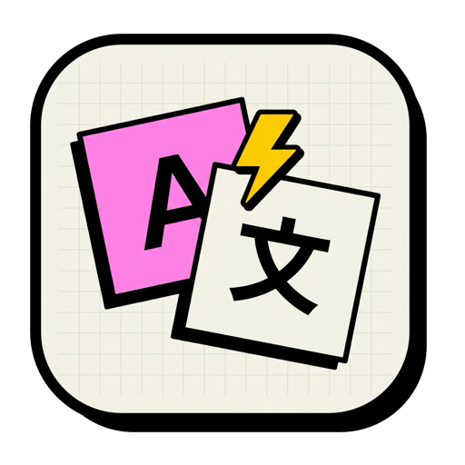
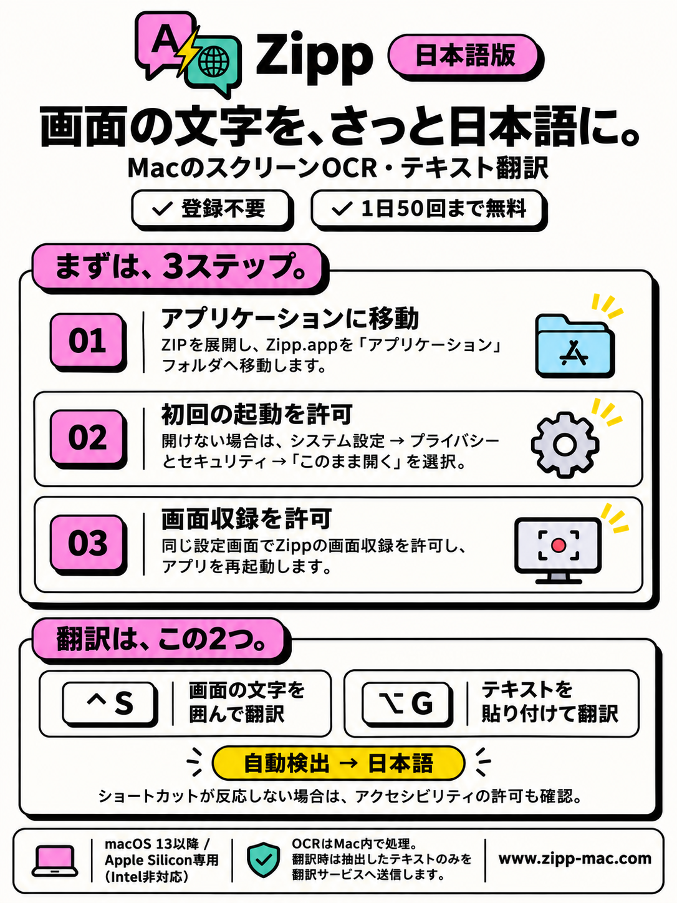

# Zipp（閃貼）— 画面の外国語を、囲んだ瞬間に読む（Mac 専用）

  

**Zipp（閃貼）** は、macOS の画面上でコピーできない PDF・エラーログ・デザイン画面の文字を `⌃S` で囲むだけで、Mac 内の Apple Vision OCR で読み取り、最前面の小窓に訳文を表示する軽量翻訳ツールです。

* 🌐 **公式サイト**: [https://www.zipp-mac.com/](https://www.zipp-mac.com/)
* 📦 **最新リリース（日本版・1.0.1 build 4 / r4-guide1）**: [Releases ページからダウンロード](../../releases/latest)
* 🎁 **料金・アカウント**: **完全無料ダウンロード・アプリ利用登録不要・1日50回まで無料**

---

## 対応環境・配布仕様

| 項目 | 内容 |
|---|---|
| **対応 OS** | macOS 13.0 Ventura 以降（Sonoma / Sequoia 対応） |
| **対応チップ** | **Apple Silicon（M1 / M2 / M3 / M4, arm64）専用** |
| **非対応環境** | **Intel プロセッサ搭載 Mac は非対応**（起動できません） |
| **UI 言語** | 日本語固定（日本向け配布版） |
| **配布ファイル** | `Zipp-Mac-JP-1.0.1-r4-guide1.zip`（`3,045,963` bytes） |
| **SHA-256** | `66920f0b335fe7526184a6004df09bcb923e77bfc49f436ecfcc3b896dee84bb` |

---

## プライバシーと通信の境界（透明性について）

* **画面画像は Mac の外へ出しません**: OCR（文字認識）はすべて端末内の **Apple Vision** フレームワークで処理され、スクリーンショット画像を外部へ送信・保存することはありません。
* **認識したテキストのみをオンライン翻訳**: 翻訳実行時には、OCR で抽出した UTF-8 テキストのみを翻訳サービスへ送信します（翻訳機能の利用にはインターネット接続が必要です）。

---

## 初回起動のご案内（未公証インディーズアプリのため）

本アプリは個人開発の無料公開ビルド（Apple 公証未取得）です。初回のみ macOS の確認画面が表示されますが、以下の手順で安全に起動できます。

1. `Zipp-Mac-JP-1.0.1-r4-guide1.zip` を展開し、`Zipp.app` を **アプリケーション（Applications）** フォルダへドラッグします。
2. Finder 上で `Zipp.app` を **右クリック（または Control + クリック）** して「**開く**」を選び、確認ダイアログでもう一度「**開く**」をクリックします。
3. うまく開けない場合は、macOS の「**システム設定 › プライバシーとセキュリティ**」下部に表示される「**このまま開く**」から許可してください（2回目以降は通常どおり起動します）。

> 配布 ZIP 内にも図解画像 [`はじめに.png`](./hajimeni.png) を同梱しています。

---

## 主なショートカット・使い方

* `⌃S`（Control + S）：画面の任意範囲をドラッグして OCR & 翻訳
* `⌥G`（Option + G）：テキスト直接入力モードで翻訳パネルを開く
* 初回の画面キャプチャ時のみ、macOS の「**画面収録**」権限の許可が必要です。

不具合報告・ご要望は [Issues](../../issues) までお寄せください。
