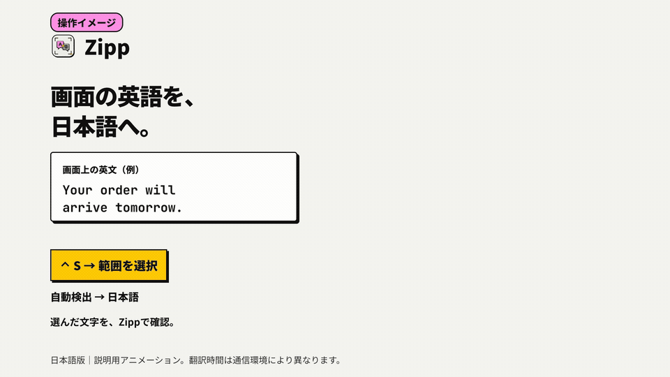
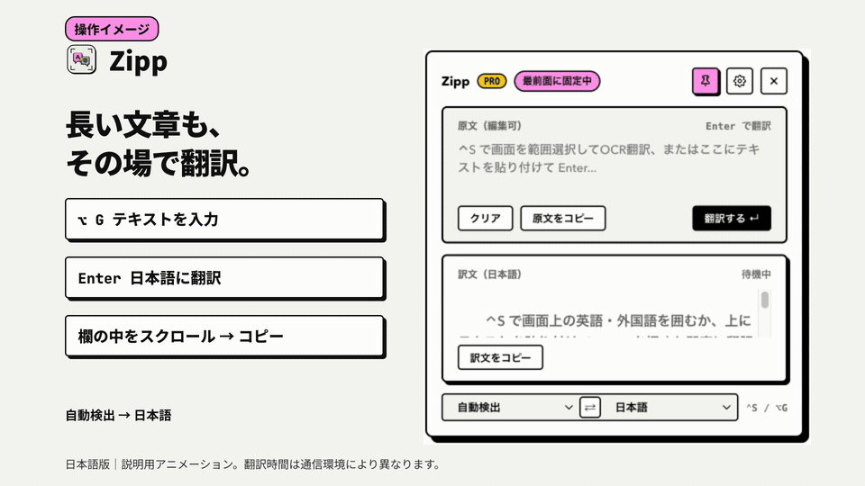

# Zipp — Mac 画面翻訳 / Screen Translation for macOS

**画面の英語を、囲むだけ。** macOS のメニューバーに常駐し、画面上の英文をその場で日本語にします。OCR は Apple Vision によるローカル実行。画面画像の外部保存は行いません。

*Capture any English text on your screen and read it in Japanese — OCR runs locally on Apple Vision. No screen image is stored externally.*

<p>
  
  
  
</p>

---

## できること



*アプリの画面を切り替えずに、囲んだ範囲だけを読む。*



*二段組の英文でも、囲んだ範囲の順序が崩れない。*

---

## 何が違うのか

英文を読むとき、実際に起きていること：

| よくある方法 | 起きる問題 |
| --- | --- |
| PDF やページからコピーして翻訳サイトに貼る | 二段組で順序が壊れる／図表・脚注が混ざる／アプリの切り替えが要る |
| スクリーンショット → 画像を翻訳アプリへ | 撮る→保存→開く→貼る→戻る、の往復が発生する |
| ブラウザの翻訳機能 | Web ページは読めるが、PDF・アプリ・ターミナル・CAD は対象外 |
| 英語を読めるようになる | 正論だが、エラーが出ている間は待ってくれない |

Zipp は **「変換しない」** 側に振っています。画面はそのまま、囲んだ範囲だけを読む。

- **メニューバー常駐** — Dock を占有しません（`LSUIElement`）
- **その場で返る** — アプリを切り替えずに結果が出ます
- **ローカル OCR** — 文字認識は端末内の Apple Vision。画面画像の外部保存は行いません
- **ショートカットは変更可** — 競合するアプリがある場合は設定で別のキーに割り当てできます
- **翻訳は選択制** — 既定の無料枠のほか、自分の API キー（OpenAI 互換の `baseURL`・モデル名を指定）で直接呼び出せます

> **翻訳の仕組みについて（透明化）**
> 文字認識（OCR）は端末内で完結します。翻訳は、無料枠の翻訳エンドポイント、またはご自身で設定した API キーのエンドポイントに対して行います。**API キー方式では、認識したテキストは選択した翻訳 API に送信されます。** 機密情報の取り扱いは各 API 提供元のポリシーに従います。

---

## 無料枠について

**無料で利用できます。クレジットカードの登録は不要です。**

利用回数には上限があります：**1日 50 回まで**。上限に達した場合は翌日にリセットされます。無料枠の範囲で使う限り、支払いは発生しません。

*Free to use — no credit card, no sign-up. Limited to 50 captures per day; the counter resets daily.*

---

## 動作環境

| 項目 | 要件 |
| --- | --- |
| macOS | **13.0 以降**（macOS 15 Sequoia を含む） |
| CPU | **Apple Silicon（arm64）専用** |
| Intel Mac | **対象外**（配布ビルドは arm64 のみ） |

配布しているビルドは Apple Silicon 向けです。Intel Mac では動作しません。

確認方法：

```bash
uname -m      # arm64 と表示されれば対象
sw_vers -productVersion
```

---

## インストール

1. [Releases](https://github.com/dayu-999/zipp-mac/releases/latest) から `Zipp-Mac-JP-1.0.1-r4-guide1.zip` をダウンロード
2. 展開して `Zipp.app` を `/Applications` に移動
3. **初回だけ「右クリック → 開く」** で起動してください

macOS の Gatekeeper により、初回は通常のダブルクリックでは開けません。アプリを右クリック（または Control + クリック）して「開く」を選ぶと起動します。2回目以降は通常のダブルクリックで起動できます。

macOS 15 Sequoia で右クリックメニューに「開く」が出ない場合は、システム設定 →「プライバシーとセキュリティ」画面下部の「このまま開く」から許可してください。

### 画面収録の許可

初回に範囲選択を行うと、macOS が「画面収録」の許可を求めます。システム設定 →「プライバシーとセキュリティ」→「画面収録」で Zipp を有効にしてください。

---

## ダウンロードの検証（SHA-256）

配布物が改ざんされていないか確認できます。

```
Zipp-Mac-JP-1.0.1-r4-guide1.zip
SHA-256: 66920f0b335fe7526184a6004df09bcb923e77bfc49f436ecfcc3b896dee84bb
size   : 3,045,963 bytes
```

```bash
# macOS
shasum -a 256 ~/Downloads/Zipp-Mac-JP-1.0.1-r4-guide1.zip
# 期待値: 66920f0b335fe7526184a6004df09bcb923e77bfc49f436ecfcc3b896dee84bb
```

値が一致しない場合は実行しないでください。

> **署名について（正直な記載）**
> 現行ビルドは ad-hoc 署名です。Apple の Developer ID 署名・公証（Notarization）は未取得のため、上記のとおり初回起動に「右クリック → 開く」が必要になります。公証済みビルドへの移行は別途対応予定です。

---

## こんな場面で使っています

- **論文**（arXiv / PubMed / IEEE の二段組 PDF）— 図表キャプションを確認しながら本文を読む
- **開発**（ターミナル、VS Code、Xcode、Docker）— 英語のエラーメッセージをその場で読む
- **3D / CAD**（Blender、Fusion 360、Unity）— 英語の警告・Python Traceback を読む
- **DTP**（Illustrator、InDesign）— アウトライン化された英文を読む
- **ゲーム**（Steam、海外 Mod、Discord）— 画面の英文を読む

---

## 技術メモ

- OCR: Apple **Vision** フレームワーク（`VNRecognizeTextRequest`）
- UI: ネイティブ macOS（`NSPanel` / floating level）
- 常駐: `LSUIElement = 1`（Dock 非表示）
- 通信先: 設定した翻訳エンドポイントのみ（翻訳内容を受け取る中継サーバーはありません）

Vision OCR の二段組処理や座標系の扱いについては、実装メモを Qiita に書いています。

---

## English

**Zipp** is a menu bar app for macOS that reads English text on your screen and shows it in Japanese, without switching apps.

- **Menu bar resident** — no Dock icon (`LSUIElement`)
- **Local OCR** — text recognition runs on-device with Apple Vision; no screen image is stored externally
- **Works on what you see** — PDFs, terminals, CAD, games; no copy-paste, no screenshots
- **Bring your own translation key** — use the built-in free tier, or point it at your own OpenAI-compatible endpoint (`baseURL`, model name)
- **Free to use, up to 50 captures per day** — no credit card, no sign-up

### Requirements

- macOS **13.0+**
- **Apple Silicon (arm64) only** — Intel Macs are not supported

### Install

1. Download the zip from [Releases](https://github.com/dayu-999/zipp-mac/releases/latest)
2. Move `Zipp.app` to `/Applications`
3. **First launch: right-click → Open** (Gatekeeper). macOS 15 Sequoia: allow it from System Settings → Privacy & Security.

### Verify

```
SHA-256: 66920f0b335fe7526184a6004df09bcb923e77bfc49f436ecfcc3b896dee84bb
```

This build is **ad-hoc signed**, not notarized. That is why the first launch requires right-click → Open.

---

## リンク

- 公式サイト / Website: <https://www.zipp-mac.com/>
- リリース / Releases: <https://github.com/dayu-999/zipp-mac/releases>

## 免責

本ソフトウェアは現状有姿で提供されます。重要な判断（契約・医療・法務など）においては、必ず原文および専門家の確認を行ってください。OCR および翻訳は誤りを含む可能性があります。

*Provided as is. OCR and translation may contain errors — always verify the original text for consequential decisions.*
